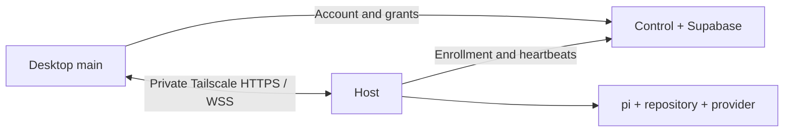
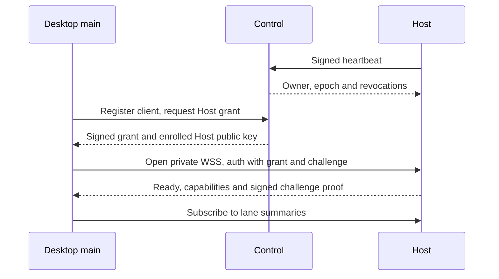
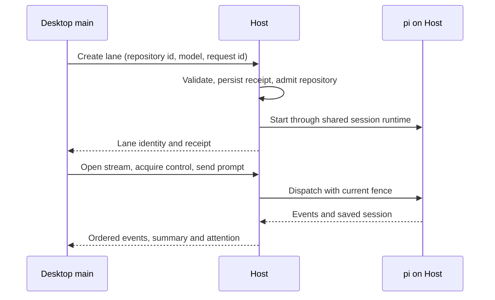

# Remote access

Remote access runs a lane on another computer while you work in Phosphor Desktop.
The Host owns pi, the checkout, provider sign-ins and durable state. Desktop shows
that machine's lanes and sends actions directly to it over your private tailnet.
Local Desktop work needs neither a Host nor a Phosphor account.

## Three parts

| Part                              | Responsibility                                                         | Runs where                         |
| --------------------------------- | ---------------------------------------------------------------------- | ---------------------------------- |
| Desktop                           | Machine selection, chat, panes and explicit control                    | Your computer                      |
| [Host](host.md)                   | The `phosphor` CLI, pi sessions, files, terminals and schedules        | The execution machine              |
| [Control plane](control-plane.md) | Account identity, enrollment, machine directory and short-lived grants | `apps/control`, backed by Supabase |

`apps/site` supplies the Astro website and guides served by `apps/control`.
Control is not a relay or a cloud agent runner.

The renderer uses typed IPC to Desktop main, not network sockets. The Host API
binds to loopback; Tailscale Serve publishes it only within the tailnet. Funnel,
public tunnels and disabling TLS verification are not part of this transport.

## Bring a machine online

1. Install pi on the execution machine. Both computers need Tailscale on the
   same tailnet, with MagicDNS and HTTPS certificates enabled.
2. Sign in to Phosphor with GitHub in Desktop. Open Machines > Add a machine.
   Its [terminal-command flow](remote-desktop.md#add-a-machine) checks local
   readiness and gives the signed Host install command to run on the other machine.
3. The command runs `phosphor setup`, which keeps or creates config, prints an
   enrollment code and fingerprint, installs and starts the service, then enables
   Tailscale Serve. In Desktop, choose I have a code, enter it, compare fingerprints
   and approve. No repository is required. Rerunning setup resumes completed steps;
   if Tailscale needs operator permission, run its printed sudo command and rerun setup.
4. Once online, open the machine's Readiness and sign in to a provider there, or
   run `phosphor providers login PROVIDER` on the Host. Credentials stay there.
   Add a repository from Desktop or with `phosphor setup --repository DIR --replace`.
   `phosphor doctor` checks readiness; `phosphor accept --repository DIR` proves
   real sessions in a disposable repository. [Acceptance](host.md#accept) explains
   when the Claude lane needs `--claude-model`.
5. Open the machine in Desktop. Readiness gives recovery steps for missing pi,
   transport or provider sign-in. An online directory row alone is not proof of a
   ready connection or permission to execute.

The [Host command and config reference](host.md#commands) covers manual operation,
signed releases, updates, rollback and uninstall. `phosphor run` is the foreground
alternative to the service. A macOS service runs at login; Linux's user service
uses linger to keep running after logout and reboot. Lane transport is private
Tailscale HTTPS/WSS, not SSH.

## Connect and authorize

Enrollment associates a machine key with your account. It does not grant execution.
Desktop registers its own client identity and asks control for a five-minute grant.
The Host authenticates that grant and proves its enrolled identity to Desktop.
Effective capabilities are the intersection of the grant and the Host's features.
[Machine Settings](settings.md#host-machine-settings) requires a separate explicit
configuration-access request; lane control alone never grants `machine.configure`.
Settings travel directly to the selected Host, with no local fallback, automatic
cross-machine configuration/auth synchronization or offline mutation queue.

A lane has one controller. Viewers can watch; mutations require current control,
the matching fence and the operation's capabilities. Takeover and release are
explicit. Disconnecting does not release control. Revocations reach open streams
through heartbeats; grant expiry bounds access during control outages. The
[protocol](remote-protocol.md) owns receipt, fence and renewal rules.

## A lane from prompt to result

Select the Host and one of its configured repositories. Folder and model choices
belong to that machine, never This Mac. An unavailable machine never causes a local
session to start instead.

New lane opens the Host home composer, not a dialog.
[Remote creation](remote-desktop.md#machine-context-and-lane-creation) owns
repository selection, thinking and branch isolation.

The Host retains the transcript and stable lane identity. Desktop keeps remote
projections in memory. Reconnection hydrates from a snapshot and cursor before
resuming live events. Down machines retain disabled, last-known rows in this app
run. An unknown receipt means the result is uncertain, not permission to repeat
an action. Refresh or inspect the lane before deciding what to do next.

## What you can use

| Surface              | Remote behavior                                                                                                                        | Contract                                                                       |
| -------------------- | -------------------------------------------------------------------------------------------------------------------------------------- | ------------------------------------------------------------------------------ |
| Machines and sidebar | Enroll, rename, remove, filter, inspect readiness and select a machine                                                                 | [UI shell](ui-shell.md#machines), [Desktop routing](remote-desktop.md)         |
| Lanes and chat       | Create, open, prompt, steer, select models/thinking, answer dialogs, take/release control, rename, stop/resume, read and delete        | [Lanes](lanes.md#remote-lanes), [Chat](chat.md)                                |
| Files and Changes    | Browse repositories without a lane; read and edit lane files with revision checks; create, rename, copy, move, trash and inspect diffs | [Files](files.md#remote-lanes)                                                 |
| Attachments          | Upload documents to the Host before prompting; images use pi's image input                                                             | [Host attachments](host.md#attachments)                                        |
| Terminal             | Watch lane shells; controllers create, type, resize and kill                                                                           | [Terminal](terminal.md#host-terminals)                                         |
| Skills and models    | Read machine skills, provider readiness and model catalogue                                                                            | [Desktop machine context](remote-desktop.md#machine-context-and-lane-creation) |
| Provider sign-in     | Use a private Host terminal from Machines Readiness                                                                                    | [Provider sign-in](remote-desktop.md#provider-sign-in)                         |
| Artifacts            | Read lane versions and the machine-tagged library; preview HTML in a local sandbox                                                     | [Remote artifacts](remote-desktop.md#remote-artifacts)                         |
| Routines             | Create paused definitions, explicitly enable schedules, run, cancel and inspect history on the Host                                    | [Routines](routines.md#host-routines)                                          |
| Attention            | Unread counters and machine-titled OS notifications                                                                                    | [Desktop connections](remote-desktop.md#desktop-host-connections)              |

[Lane notices](chat.md#lane-notices) show run receipts and open the destination
without losing its machine context.

Each feature is capability-gated. Connection loss disables actions; failed reads
show Unavailable, not fabricated zero counts or local data. Unsupported remote
operations and future clients live in [future features](future-features.md#remote-surface-gaps).
Reproducing defects live in [known issues](known-issues.md#host-lanes).

## Trust boundary

- **Private Tailscale only.** The Host listens on `127.0.0.1`; Serve exposes its
  verified HTTPS endpoint inside the tailnet. Never use Funnel.
- **No lane data in control.** It stores identity and machine metadata, including
  Host public keys and aggregate counts. It never receives prompts, transcripts,
  paths, repository names, files, artifacts or provider credentials. It never
  probes submitted endpoints or proxies execution.
- **Private keys stay on their owner.** The Host's identity private key stays on
  the Host. Control stores only its public key. Desktop account tokens stay in
  main's [account vault](settings.md#phosphor-account), not the renderer.
- **No remote-to-local fallback.** Opaque Host resource keys are not local paths.
  Unrouted machine actions fail closed rather than touch this computer's files,
  providers or subprocesses.
- **Full tool access remains full tool access.** Grants and controller fences
  authorize access to a Host, not a sandbox around pi. The Host chooses its own
  executables, environment, repositories and extension resources. A caller cannot
  supply spawn settings. Routine activation explicitly acknowledges unattended
  full tool access.
- **Remote content stays remote or in memory.** Transcripts, artifacts, files and
  terminal output are not cached on Desktop disk. Explicit Save/PDF export targets
  This Mac. Artifact HTML remains sandboxed without `allow-same-origin` or network
  access. Committed attachment paths are the documented prompt-only path exception.

## Reference map

- [Host](host.md): every CLI command, config key, service and release operation.
- [Control plane](control-plane.md): routes, Auth, grants, database and deployment.
- [Desktop](remote-desktop.md): machine context, connections, routing and isolation.
- [Protocol](remote-protocol.md): frames, bounded streams, receipts and grants.
- [Development and diagnostics](remote-development.md): safe local validation,
  transport probes, end-to-end fixtures and tracing across processes.
