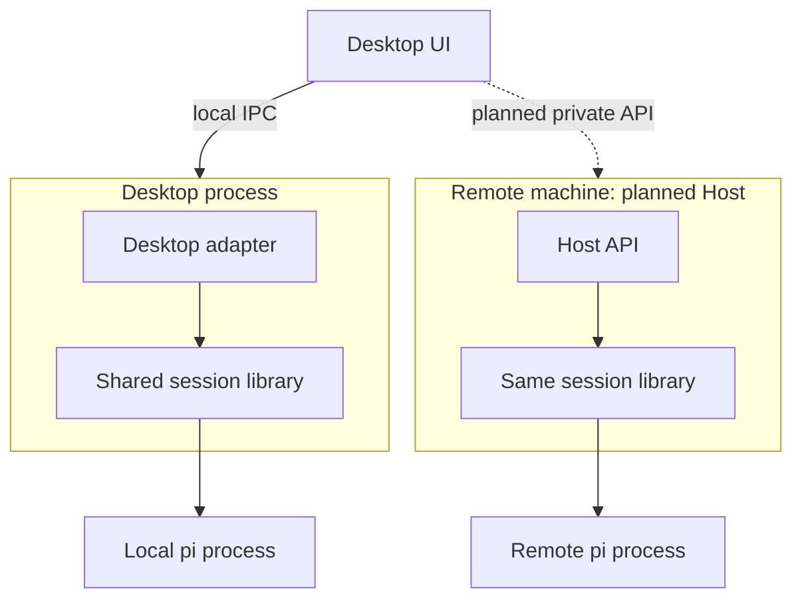
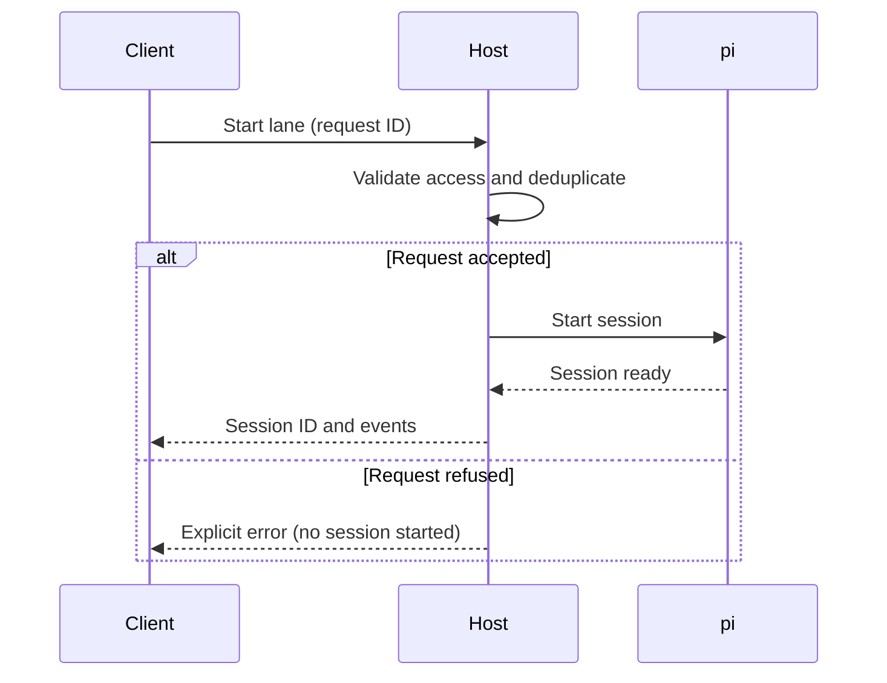
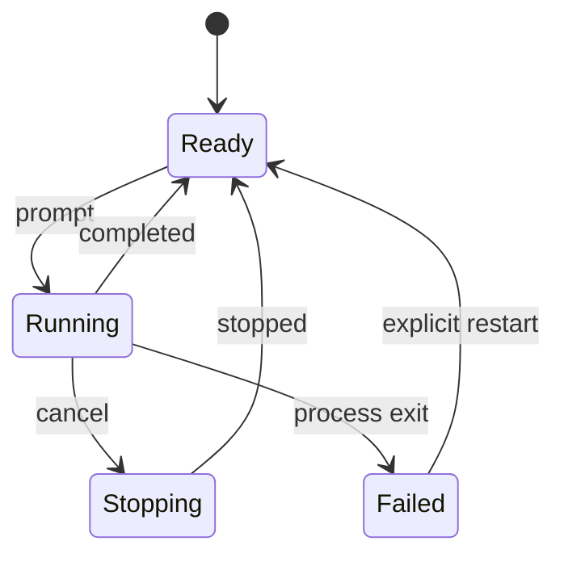

# Mermaid recipes

Use fenced `mermaid` inside Markdown, or raw Mermaid as a `mermaid` artifact.
Phosphor supplies theming and a zoom/pan viewer. Mermaid is NOT automatically
available inside an HTML artifact; use Markdown or pre-rendered inline SVG
there, never a CDN script.

Choose one question per diagram. Keep labels short, quote punctuation-heavy
labels, and split a large topology into overview and detail. Prefer top-to-bottom
for narrow panels. State which boundaries are process, machine or trust boundaries.
Distinguish planned paths in labels and/or dashed edges, not color alone.

## Architecture: ownership and boundaries

Text alternative: local requests stay inside Desktop's local path; the proposed
remote path uses a second deployment of the same library on another machine.

## Sequence: order and failures

## States: legal transitions

For delivery plans use a flowchart with dependency arrows and explicit labels
such as `Done`, `In progress`, `Blocked`. Do not imply a timeline with fabricated
dates. Check every arrow against the actual dependency or transition contract.
